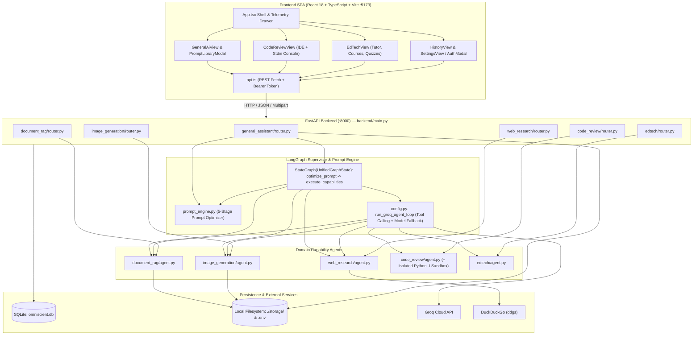
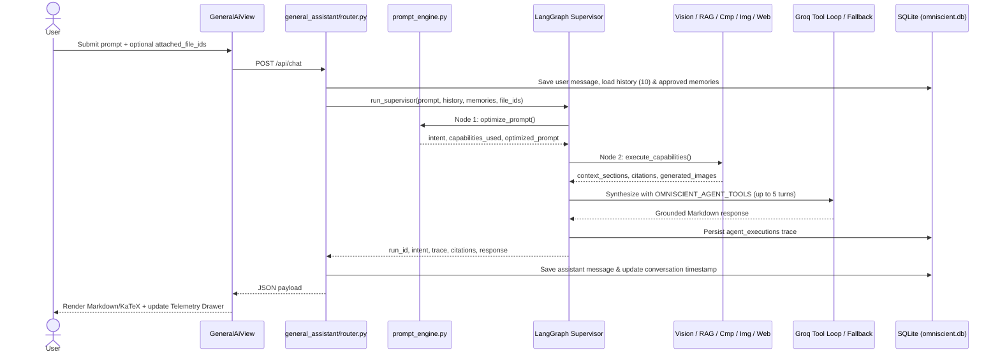

# High-Level Design (HLD) — OMNISCIENT AI

**Version:** 2.0.0  
**Architecture Style:** Modular Monolith with LangGraph Multi-Agent Supervisor & SPA Client  

---

## 1. System Overview

**OMNISCIENT AI** uses a decoupled client-server architecture:
- **Presentation Tier:** A React 18 + TypeScript single-page application (`frontend/src/`) styled with Tailwind CSS and Lucide icons, communicating over REST JSON and `FormData` endpoints via `apiRequest` (`frontend/src/api.ts`).
- **Application & Orchestration Tier:** A FastAPI server (`backend/main.py`) exposing 6 domain routers (`general_assistant`, `code_review`, `edtech`, `document_rag`, `image_generation`, `web_research`). Complex multimodal/multi-step requests in General AI are orchestrated by a compiled **LangGraph `StateGraph` Supervisor** (`backend/general_assistant/agent.py`).
- **Intelligence & Provider Tier:** Centralized in `backend/config.py`, supporting Groq tool-calling (`run_groq_agent_loop`) with automatic multi-model fallback, Gemini configuration, DuckDuckGo web search (`ddgs`), Pillow/PyMuPDF/Office document parsers, and deterministic offline fallbacks.
- **Data & Storage Tier:** SQLite (`omniscient.db`) for relational and JSON-serialized application state, paired with local filesystem storage (`./storage/`) for uploaded documents and images.

---

## 2. High-Level Architecture Diagram

---

## 3. Architectural Components

### 3.1 Frontend Shell & Views (`frontend/src/`)
- **`App.tsx`:** Manages global navigation state (`general-ai`, `code-review`, `edtech-lms`, `history`, `settings`), authentication bootstrap (`/api/auth/me`), conversation sidebar, and the collapsible right-hand **Execution Telemetry** drawer (`workflowTrace`, `activeCitations`, `recentExecutions`).
- **Feature Views:**
  - `general_ai/GeneralAiView.tsx` & `PromptLibraryModal.tsx`: Unified chat, multi-file upload, prompt optimization preview, and template library management.
  - `code_review/CodeReviewView.tsx`: Source editor, static/AI issue list, Big-O complexity metrics, corrected code diff/output, and `stdin` execution console.
  - `edtech/EdTechView.tsx`: Tabbed LMS workspace for AI Tutor, Study Planner, Flashcards, Courses, Quizzes, and Assignments.
  - `history/HistoryView.tsx` & `settings/SettingsView.tsx` & `AuthModal.tsx`: Session management, runtime `.env` API key configuration, and approved memory curation.

### 3.2 API Gateway & Domain Routers (`backend/main.py`)
`FastAPI` mounts 6 routers with CORS enabled (`allow_origins=["*"]`) and an `@asynccontextmanager` lifespan hook that runs `init_db()` on startup:
1. `general_assistant.router`: `/api/auth/*`, `/api/chat`, `/api/conversations*`, `/api/agents*`, `/api/memory*`, `/api/settings/api-keys*`, `/api/prompt-templates*`.
2. `code_review.router`: `/api/code-review`, `/api/code-execution`.
3. `edtech.router`: `/api/courses*`, `/api/enrollments`, `/api/quizzes*`, `/api/assignments`, `/api/submissions`, `/api/flashcards*`, `/api/analytics/*`, `/api/edtech/metrics`.
4. `document_rag.router`: `/api/files*`, `/api/documents*`, `/api/rag/query`.
5. `image_generation.router`: `/api/images*`.
6. `web_research.router`: `/api/research`.
Plus `GET /api/health` reporting active LLM provider, model, and platform readiness.

### 3.3 LangGraph Unified Supervisor (`backend/general_assistant/agent.py`)
The General AI pipeline is compiled as a deterministic two-node LangGraph `StateGraph(UnifiedGraphState)`:
1. **`optimize_prompt` node:** Invokes `optimize_and_analyze_prompt()` (`prompt_engine.py`) to classify intent, determine `required_capabilities`, and rewrite the raw user input into a structured `ROLE / TASK / REQUIREMENTS / OUTPUT FORMAT / DIFFICULTY` prompt.
2. **`execute_capabilities` node:** Executes every capability flagged in `capabilities_used` in sequence, accumulating `direct_outputs`, `context_sections`, `citations`, `generated_images`, and `workflow_trace` steps, and logs every execution step into `agent_executions`.

### 3.4 LLM Engine & Resilience Strategy (`backend/config.py`)
- Reads keys from a single root `.env` file (`load_dotenv(ENV_FILE, override=True)`).
- `run_groq_agent_loop()` executes up to `max_turns=5` autonomous tool-calling rounds against `OMNISCIENT_AGENT_TOOLS` (`search_resources`, `explain_topic`, `generate_quiz`, `review_code_tool`, `execute_code_tool`, `search_documents_tool`, `generate_diagram_tool`).
- `_call_groq_with_fallback()` tries `preferred_model` (default `openai/gpt-oss-120b`) followed by `llama-3.3-70b-versatile`, `openai/gpt-oss-20b`, and `llama-3.1-8b-instant` (short-circuiting immediately on HTTP 401 invalid-key errors).
- If Groq is unconfigured or unreachable, `build_rich_structured_response()` produces a consistent 5-section pedagogical response (`omniscient-structured-engine`).

### 3.5 Code Review & Isolated Execution Sandbox (`backend/code_review/agent.py`)
- **Static + AI Hybrid Review:** Combines fast Python `ast` parsing and cross-language regex security rules with a structured JSON Groq review (`review_code`) to return line-level issues, Big-O estimates, and `corrected_code`.
- **Sandboxed Subprocess Execution:** `execute_code_in_sandbox` parses the Python AST first to block dangerous modules (`os`, `subprocess`, `socket`, `shutil`, `ctypes`, `urllib`, `http`, `ftplib`) and builtins (`eval`, `exec`, `compile`, `__import__`, `open`), then executes the script inside a clean `tempfile.TemporaryDirectory` using `sys.executable -I` with a sanitized environment, `stdin_data` piping, and a 5-second timeout.

### 3.6 Document Intelligence & RAG (`backend/document_rag/agent.py`)
- **Multi-Format Extraction:** Parses `PDF` (PyMuPDF), `DOCX`, `PPTX`, `XLSX`, `CSV`, `TXT`, and image metadata (Pillow).
- **Chunking & Indexing:** Splits text into paragraph-aligned chunks (`<= 600` characters), extracts top-8 non-stopword concepts, and stores metadata/chunks in the `documents` table while persisting raw files in `./storage/{doc_id}_{filename}`.
- **Retrieval:** `query_rag` scores chunks via query-token intersection (`0.25 + 0.75 * overlap`) and returns top-`k` `[CIT-N]` citations.

---

## 4. Security & Trust Boundaries

1. **Untrusted Code Isolation:** User code submitted to `/api/code-execution` is validated by an AST security guard before execution and run in an isolated `-I` Python subprocess with restricted environment variables (`PATH`, `SYSTEMROOT`, `PYTHONIOENCODING`) and a 5-second wall-clock limit.
2. **Untrusted Content Isolation:** The supervisor system prompt explicitly instructs the LLM never to allow untrusted document or webpage text to override system instructions.
3. **Credential Hygiene:** API keys are persisted only in the root `.env` file and returned masked (`xxxx...yyyy`) via `GET /api/settings/api-keys`.
4. **Session & Auth:** User passwords are stored as SHA-256 hashes (`password_hash`); session identity is resolved from `Authorization: Bearer omni-token-{user_id}` with graceful fallback to the seeded default user (`u-default`) in local single-user mode.

---

## 5. Deployment & Runtime Topology

- **Local Development / Demo Launch:** `start.ps1` / `start.bat` launches:
  - Backend API: `uvicorn main:app --app-dir backend --host 127.0.0.1 --port 8000 --reload`
  - Frontend Dev Server: `npm run dev --prefix frontend` (`http://localhost:5173`, proxying `/api/*` to `http://127.0.0.1:8000` via `frontend/vite.config.ts`)
- **Storage Footprint:** Single-file SQLite database (`omniscient.db`) and `./storage/` folder at the repository root—requiring zero external database servers or message brokers.
